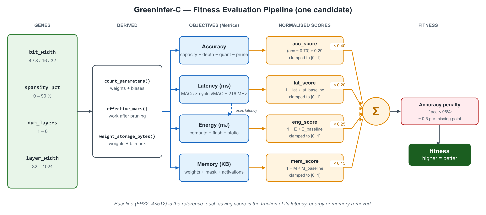
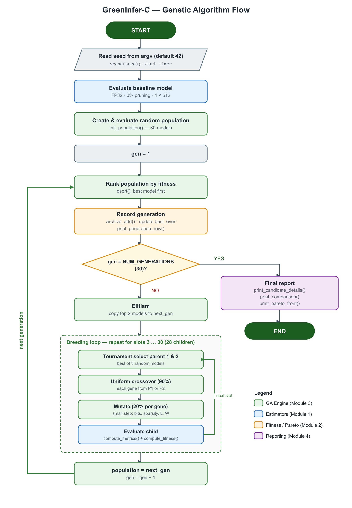
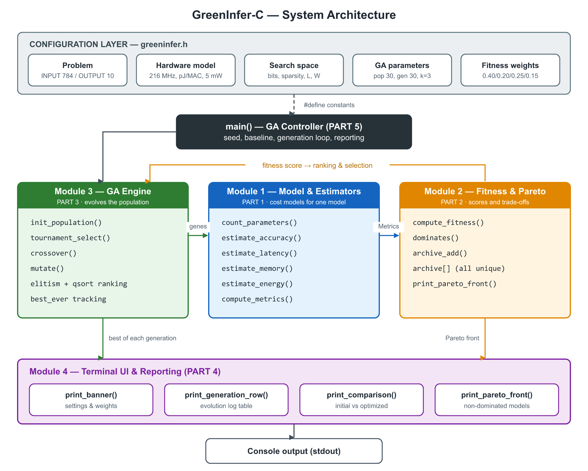

# GreenInfer-C

**Multiobjective Genetic Optimization of Accuracy, Latency, Energy and Memory for C-Based Edge-AI Inference**

A C program that uses a Genetic Algorithm to automatically find a compressed AI model that is small, fast and energy-efficient enough to run on a microcontroller, while keeping accuracy at 96% or more.

---

## Team details

| | |
|---|---|
| **Team number** | [Team No.] |
| **Batch** | 10 |

| Member | ID |
|---|---|
| Tanishq Surve | 590032902 |
| Sudhanshu Jha | 590036335 |
| Utkarsh Mishra | 590033754 |
| Arnika Saini | 590041798 |

---

## Problem statement

AI is moving from cloud servers onto small devices such as smart watches, sensors and cameras ("Edge-AI"). These devices run on microcontrollers with about **1 MB** of memory and a small battery.

A typical neural network stored as 32-bit floating-point numbers (4 hidden layers × 512 neurons) needs about **4.6 MB**. It does not fit, and it uses too much energy and time per prediction.

The model can be shrunk by reducing the bit-width (quantization), removing weights (pruning), or using fewer or smaller layers. But every change also lowers accuracy, and there are **2,736** possible combinations. Finding the best balance by hand is slow and unreliable.

**Goal:** write a C program that searches these combinations automatically and finds the model with the best balance of **accuracy, latency, energy and memory**.

---

## Objectives

1. Represent each candidate AI model by four settings (genes): bit-width, pruning percentage, number of layers and layer width.
2. Estimate four objectives for every model: accuracy (%), latency (ms), energy (mJ) and memory (KB).
3. Combine them into one weighted fitness score, with a minimum accuracy rule of 96%.
4. Use a Genetic Algorithm to find the best model automatically.
5. Show progress for every generation and a final comparison against the original model.

## Features

- Complete Genetic Algorithm: random initial population, tournament selection, uniform crossover, mutation and elitism.
- Four-objective evaluation using cost models of an ARM Cortex-M7 microcontroller (216 MHz).
- Weighted fitness function with an accuracy penalty below 96%.
- Pareto-front analysis that lists all the best trade-off models.
- Clean console tables: per-generation evolution log, final comparison with % savings, and the Pareto front.
- Repeatable runs with a fixed random seed, or a seed given on the command line.
- Pure C99, using only the standard library. Compiles with zero warnings under `-Wall -Wextra -pedantic`.
- A separate exhaustive test proves the result is the global optimum.

---

## Project structure

```
├── README.md                  this file
├── main.c                     complete program (estimators, fitness, GA, output)
├── greeninfer.h               constants, structs and function prototypes
├── presentation.pptx          project presentation
├── flowchart.png              Genetic Algorithm flowchart
├── architecture.png           system architecture diagram
├── fitness_pipeline.png       how one model's fitness is calculated
├── tests/
│   ├── verify_optimum.c       exhaustive test of all 2,736 models
│   ├── output_seed42.txt      actual output, seed 42
│   ├── output_seed7.txt       actual output, seed 7
│   ├── output_seed123.txt     actual output, seed 123
│   ├── output_seed_invalid.txt actual output, invalid seed "abc"
│   └── output_verify_optimum.txt actual output of the exhaustive test
└── screenshots/
    ├── sample_output_1_evolution.png
    ├── sample_output_2_results.png
    └── test_verify_optimum.png
```

---

## How it works

### Data design

```c
typedef struct {            /* the four objectives of one model */
    double accuracy, latency_ms, energy_mj, memory_kb;
    long   params_total, params_nonzero;
} Metrics;

typedef struct {            /* one candidate model = one GA individual */
    int     bit_width;      /* gene 1: 4, 8, 16 or 32 bits             */
    int     sparsity_pct;   /* gene 2: 0 to 90 % pruned (steps of 5)   */
    int     num_layers;     /* gene 3: 1 to 6 hidden layers            */
    int     layer_width;    /* gene 4: 32 to 1024 neurons per layer    */
    Metrics m;
    double  fitness;
} ModelCandidate;
```

Search space: 4 bit-widths × 19 pruning levels × 6 depths × 6 widths = **2,736 models**.

### Objective estimation (cost models)

| Objective | How it is calculated |
|---|---|
| Accuracy | Capacity curve (bigger networks are more accurate) + depth bonus − quantization loss − pruning loss |
| Latency (ms) | operations × cycles per operation ÷ 216 MHz, plus a small overhead per layer |
| Energy (mJ) | compute energy (pJ per operation) + flash read energy + static leakage power × time |
| Memory (KB) | non-zero weights × bits ÷ 8 + pruning bitmask + two activation buffers |

### Fitness function

```
fitness = 0.40 × accuracy_score + 0.20 × latency_saved
        + 0.25 × energy_saved   + 0.15 × memory_saved

if accuracy < 96 %:  fitness −= 0.5 × (missing percentage points)
```

Each score is scaled to 0–1. The "saved" scores are the fraction saved compared with the original model.



### Algorithm (pseudocode)

```
READ seed (default 42); srand(seed)
baseline ← FP32, 0 % pruning, 4 × 512;  evaluate baseline
population ← 30 random models;  evaluate each

FOR gen = 1 TO 30
    sort population by fitness (best first)
    add every model to the archive; update best_ever
    PRINT best model of this generation
    IF gen = 30 THEN BREAK

    next[0..1] ← population[0..1]                    // elitism
    FOR i = 2 TO 29
        p1 ← tournament_select(population)            // best of 3
        p2 ← tournament_select(population)
        child ← crossover(p1, p2)                      // uniform, 90 %
        mutate(child)                                  // 20 % per gene
        evaluate(child)
        next[i] ← child
    population ← next

PRINT best_ever, comparison with baseline, Pareto front
```

### Flowchart



### System architecture



| Part of main.c | Responsibility | Key functions |
|---|---|---|
| PART 1 | Model and objective estimation | `make_baseline`, `random_candidate`, `estimate_accuracy`, `estimate_latency`, `estimate_energy`, `estimate_memory` |
| PART 2 | Fitness and Pareto analysis | `compute_fitness`, `dominates`, `archive_add`, `print_pareto_front` |
| PART 3 | Genetic Algorithm operators | `init_population`, `tournament_select`, `crossover`, `mutate` |
| PART 4 | Terminal output | `print_banner`, `print_generation_row`, `print_comparison` |
| PART 5 | Main generation loop | `main` |

---

## C programming concepts used

| Concept | Where it is used |
|---|---|
| Structures and `typedef` | `Metrics` and `ModelCandidate` hold each model's genes and results |
| Arrays of structures | `population[]`, `next_gen[]` and `archive[]` |
| Pointers and `const` pointers | Functions receive `ModelCandidate *` to fill results; `const` for read-only inputs |
| Functions and modular design | Each task is a small function, grouped into five parts |
| Header file with include guard | `greeninfer.h` holds shared constants, structs and prototypes |
| Preprocessor macros (`#define`) | All tunable settings: population size, rates, weights, hardware constants |
| Static variables and storage | `static` archive and helper functions private to `main.c` |
| Function pointers | `qsort()` with custom comparators to rank models by fitness or energy |
| Random numbers | `rand()` and `srand()` for initialisation, selection, crossover and mutation |
| Math library | `exp()` and `pow()` in the accuracy model |
| Command-line arguments | `argc` / `argv` to pass a random seed; `strtoul()` to convert it |
| Loops, conditionals and `switch` | Generation loop, tournaments, per-bit-width costs |
| String and memory functions | `snprintf`, `memset`, `memcpy` |
| Formatted output | `printf` for aligned tables |
| Time functions | `clock()` to measure run time, `time()` for a time-based seed |

---

## Compile and run

**Requirements:** GCC or Clang with C99 support. On Windows, use MinGW or MSYS2.

```bash
# Compile
gcc -std=c99 -Wall -Wextra -O2 main.c -o greeninfer -lm

# Run with the default seed (42): the same output every time
./greeninfer

# Run with a different seed
./greeninfer 7

# Run with a time-based seed
./greeninfer 0
```

On Windows the program is `greeninfer.exe`, run as `.\greeninfer.exe`.

**Run the exhaustive verification test:**

```bash
cd tests
gcc -std=c99 -Wall -Wextra -O2 verify_optimum.c -o verify_optimum -lm
./verify_optimum
```

---

## Sample test cases

All actual outputs below come from real runs. The full outputs are in [tests/](tests/).

| # | Test case | Input | Expected output | Actual output | Result |
|---|---|---|---|---|---|
| TC1 | Clean compilation | `gcc -std=c99 -Wall -Wextra -pedantic main.c -lm` | Compiles with no errors or warnings | 0 errors, 0 warnings | Pass |
| TC2 | Baseline model is evaluated correctly | `./greeninfer` | FP32, 4 × 512: 1,195,018 parameters, about 4.6 MB, does not fit in 1 MB | 1,195,018 params, 98.20 %, 22.380 ms, 0.7214 mJ, 4674.2 KB, "Baseline: NO" | Pass |
| TC3 | Optimization with the default seed | `./greeninfer` (seed 42) | Best model has accuracy ≥ 96 % and lower energy and memory than the baseline | INT8, 30 % pruned, 4 × 256: 96.54 %, 0.0407 mJ (−94.4 %), 324.5 KB (−93.1 %), 13.5× faster | Pass |
| TC4 | Result does not depend on the seed | `./greeninfer 7` | Same best model as TC3 | INT8 s30% 4x256, 96.54 % | Pass |
| TC5 | Result does not depend on the seed | `./greeninfer 123` | Same best model as TC3 | INT8 s30% 4x256, 96.54 % | Pass |
| TC6 | Invalid input | `./greeninfer abc` | No crash; falls back to a time-based seed | Seed 1794673939 used; INT8 s30% 4x256 found | Pass |
| TC7 | Elitism keeps the best model | `./greeninfer` | Best fitness never decreases between generations | 0.5221 → 0.8952 → 0.9194 → 0.9264 → 0.9267 (then constant) | Pass |
| TC8 | GA finds the global optimum | `tests/verify_optimum` | The exhaustive best of all 2,736 models equals the GA result | 2,736 evaluated, best = INT8 s30% 4x256, fitness 0.9267 | Pass |

**Hand check for TC2.** Parameters = 784×512 + 3×512×512 + 512×10 + (4×512 + 10) = 401,408 + 786,432 + 5,120 + 2,058 = **1,195,018**. Memory = (1,195,018 × 4 bytes + 2 × 784 × 4 bytes) ÷ 1024 = **4674.2 KB**. Both match the program output.

### Sample output


---

## Results

| Metric | Original model | GreenInfer-C model | Change |
|---|---|---|---|
| Configuration | FP32, 0 % pruned, 4 × 512 | INT8, 30 % pruned, 4 × 256 | |
| Accuracy | 98.20 % | 96.54 % | −1.66 points |
| Latency | 22.380 ms | 1.661 ms | 13.5× faster |
| Energy | 0.7214 mJ | 0.0407 mJ | **94.4 % saved** |
| Memory | 4674.2 KB | 324.5 KB | **93.1 % saved** |
| Fits in 1 MB? | No | Yes | |

The GA found this model by generation 6, after evaluating about 200 of the 2,736 possible models (about 7 %).

---

## Limitations and future scope

- The objectives come from hardware cost models, not from measurements on a physical board. Future work: run the model on an STM32 board and replace the `estimate_*` functions with real measurements; the GA does not need to change.
- Every layer uses the same bit-width and pruning level. Future work: mixed precision, with different settings for each layer.
- Future work: use NSGA-II to evolve the whole Pareto front directly.
